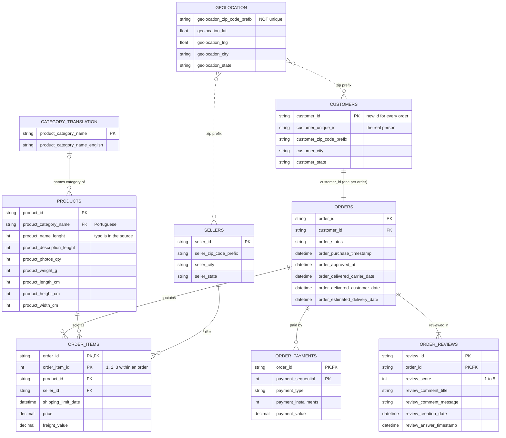

# Data Model: Olist E-Commerce

The dataset has 9 tables. **`orders` sits at the centre**, and almost every question starts from it. Keys and relationships below were checked against the actual data, not just the documentation.

## Entity-Relationship Diagram

**How to read the line ends** (crow's foot notation): `||` = exactly one, `|o` = zero or one, `|{` = one or more, `o{` = zero or more. A dotted line means the columns match but neither side is a unique key.

## What each table holds

| Table | One row = (the *grain*) | Rows | Unique key |
|---|---|---:|---|
| `orders` | one order | 99,441 | `order_id` |
| `customers` | the buyer record **for one order** | 99,441 | `customer_id` |
| `order_items` | one item line inside an order | 112,650 | `order_id` + `order_item_id` |
| `order_payments` | one payment method used on an order | 103,886 | `order_id` + `payment_sequential` |
| `order_reviews` | one review of an order | 100,000 | `review_id` + `order_id` |
| `products` | one product | 32,951 | `product_id` |
| `sellers` | one seller | 3,095 | `seller_id` |
| `product_category_name_translation` | one category (Portuguese → English) | 71 | `product_category_name` |
| `geolocation` | one GPS point for a zip-code prefix | 1,000,163 | none (19,015 distinct prefixes) |

## Traps to remember

1. **`customer_id` is not a customer.** Olist creates a new `customer_id` for every order, so `orders` ↔ `customers` is one-to-one. To count real people, use `customer_unique_id`: the 99,441 customer IDs belong to only 96,096 people.
2. **Fan-out (double counting).** One order can have several items *and* several payments. Joining `orders` to both in one query multiplies the rows: 2 items × 2 payments = 4 rows, so revenue gets counted twice. Summarise each child table to one row per order *before* joining.
3. **Reviews aren't one per order.** 559 orders have more than one review row, and some `review_id`s appear on more than one order.
4. **Geolocation has many points per zip prefix.** On average about 53 points per prefix. Reduce it to one row per prefix (for example, the average latitude and longitude) before joining. 278 customer rows have a prefix with no geolocation match.
5. **Orphans and gaps:**
   - 775 orders have no items, and 1 order has no payment.
   - 610 products have no category.
   - 13 products have a category that's missing from the translation table.

## First look: what the data says

| Finding | Number | What it means for the analysis |
|---|---|---|
| **Time period** | Orders from 4 Sep 2016 to 17 Oct 2018. Only 329 orders before 2017 (none in Nov 2016) and 20 after Aug 2018. | Monthly trends use **Jan 2017 – Aug 2018**: 20 complete months covering 99.6% of orders. The thin months at either end would look like fake drops. |
| **Order status** | 96,478 of 99,441 orders delivered (**97.0%**). 625 canceled, 609 unavailable, the rest still in progress. | Revenue is based on delivered orders, because canceled orders never became real sales. |
| **Repeat customers** | 96,096 real people, and only **2,997 (3.1%)** ordered more than once. | Retention is the big business story: almost every customer buys once and never returns. |
| **Zip codes** | 23,995 customer zip prefixes (24%) start with `0`, for example `09790`. | Zip codes must be stored as **text**. As numbers, `09790` becomes `9790` and no longer matches the geolocation table. Opening the CSV directly in Excel does exactly this. |
